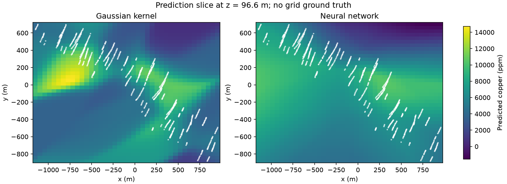
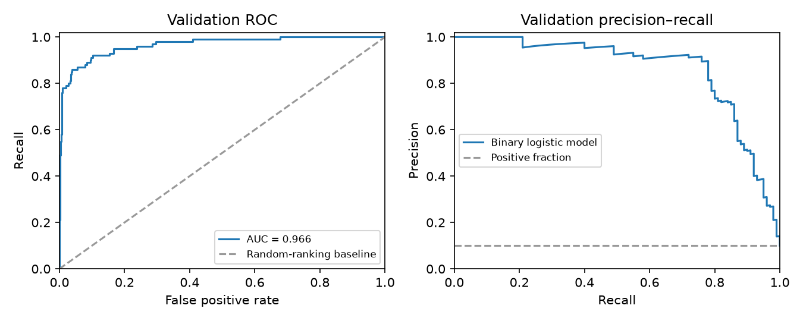

# Statistical Modeling and Machine Learning: Course Projects

Three individual projects from **DASC 3230 (Statistical Modeling and Machine Learning)** at HKUST, completed as part of my BSc in Data Analytics.

Each project follows the same discipline: **split the data so evaluation reflects the real use case, select models on validation data only, then report the reserved test set once**. Core algorithms (cross-validation, ridge regression, kernel regression, K-means, training loops) are implemented from scratch in NumPy and PyTorch rather than called from a library.

| # | Project | Methods | Headline result |
|---|---|---|---|
| 1 | [Predicting concrete strength for unseen recipes](#1-predicting-concrete-strength-for-unseen-recipes) | OLS, ridge, lasso, polynomial features, grouped K-fold CV | Test RMSE **8.75 MPa** vs 10.73 MPa for the linear baseline (−18%) |
| 2 | [Spatial copper prediction & handwritten digit classification](#2-spatial-copper-prediction--handwritten-digit-classification) | Gaussian kernel regression, feed-forward neural nets, logistic & softmax classifiers | MNIST 10-class test accuracy **91.4%**; digit-5 detector AUC **0.963** |
| 3 | [Radio-signal structure & fashion image classification](#3-radio-signal-structure--fashion-image-classification) | PCA, K-means (NumPy), kernel density screening, CNN | Pulsar recall **78%** at a 4.5% false-alarm rate; CNN test accuracy **97.8%** |

**Tech stack:** Python · NumPy · PyTorch · scikit-learn · Matplotlib · Jupyter

---

## 1. Predicting concrete strength for unseen recipes

📁 [`individual_project_v1_student/`](individual_project_v1_student/)

**Goal:** Predict the compressive strength (MPa) of concrete from seven ingredient amounts plus age, and make sure the model works for **recipes it has never seen**.

**Data:** 1,030 lab measurements (1,005 after removing duplicates) of the UCI Concrete Compressive Strength dataset.

**What I did**
- **Leak-free splitting.** The same recipe is often measured at several ages. I grouped rows by recipe, so every measurement of a recipe stays in one split (341 development recipes, 86 held-out test recipes). Cross-validation used 5 folds of recipe groups.
- **Built the modelling pipeline from scratch:** standardization fitted on training folds only, polynomial feature expansion (degrees 1–3) with re-standardized expanded columns, OLS via least squares, ridge via augmented least squares, and lasso.
- **Compared 21 candidates** (OLS / ridge / lasso × degree × λ) by 5-fold CV RMSE against a mean-response baseline (16.28 MPa).
- **Packaged a reusable predictor** that saves its scaling statistics and coefficients (`outputs/model.npz`) and flags new inputs outside the training range.

**Results**
| Model | CV RMSE | Test RMSE |
|---|---|---|
| Mean-response baseline | 16.28 MPa | — |
| Degree-1 OLS (reference) | 10.51 MPa | 10.73 MPa |
| **Ridge, degree 2, λ = 0.1 (selected)** | **8.02 MPa** | **8.75 MPa** |

Quadratic features captured non-linear effects such as diminishing returns from cement and age–water interactions, while degree-3 OLS clearly overfit. The residual plot shows mild heteroscedasticity at high strengths. One of the five new query recipes (age 500 days) was flagged as an extrapolation beyond the 365-day training maximum.

---

## 2. Spatial copper prediction & handwritten digit classification

📁 [`individual_project_2/`](individual_project_2/)

### Part A: Copper grade from drill-hole coordinates
**Goal:** Predict copper concentration (ppm) at **new drill holes** using only x, y, z coordinates.

**Data:** 2,000 rock samples from 119 drill holes (an obfuscated real deposit, GeoMet). Whole holes were assigned to train (71) / validation (24) / test (24), so the evaluation measures performance at unseen holes.

**What I did**
- Implemented **Gaussian kernel (Nadaraya–Watson) regression** from scratch with batched matrix computation, and tuned the bandwidth on validation MSE.
- Built and trained **fully connected networks** (`3→16→1`, `3→32→1`, `3→32→32→1`) in PyTorch with a hand-written training loop, SGD with a StepLR schedule, and best-checkpoint restoration.
- Exported both predictors with their scaling statistics and verified that reloaded models reproduce predictions.

| Model | Test RMSE (ppm) |
|---|---|
| Training-mean baseline | 7,798 |
| **Kernel regression (σ = 0.2)** | **7,526** |
| Neural network `[32, 32]` | 7,614 |

Both models beat the baseline only modestly. Copper grade at unseen holes is hard to predict from location alone, and the comparison of training and validation curves makes that limitation explicit.

<p align="center">
  
</p>

### Part B: MNIST digit detection and recognition
- **Binary detector for digit 5** (logistic model, 784→1). I chose the decision threshold (0.2) on validation to favour recall. On test it reached **87% recall / 69.6% precision** (vs 71.5% recall at the default 0.5), with **ROC AUC 0.963**.
- **10-class recognizer:** a softmax-linear model (90.4% test accuracy) compared with a one-hidden-layer MLP `784→64→10`. The MLP was selected on validation and scored **91.4% test accuracy**.

<p align="center">
  
</p>

---

## 3. Radio-signal structure & fashion image classification

📁 [`individual_project_3/`](individual_project_3/)

### Part A: Unsupervised structure in pulsar candidates (HTRU2)
- **PCA** on four standardized signal features: two components retain **85.3%** of the variance (reconstruction MSE 0.147).
- **K-means implemented in NumPy** (assignment and centre-update steps, best of 10 initializations). One cluster is 97% background, while the other concentrates most pulsars (112 of 150) but still mixes in background candidates. The clusters reflect the classes without matching them exactly.

### Part B: Anomaly screening with kernel density estimation
- Fitted a **Gaussian KDE on background (non-pulsar) candidates only**, choosing the bandwidth by cross-validated log-likelihood.
- Set the alarm threshold at the 95th percentile of a separate background calibration sample, and treated anything less typical than that as a candidate.
- **Test results:** recall on pulsars **78%** (78/100) at a background false-alarm rate of **4.5%** (36/800), precision 68.4%.

### Part C: Fashion-MNIST CNN
- Built a small **convolutional neural network** in PyTorch (2× Conv–ReLU–MaxPool → Linear) to classify T-shirts, trousers and bags.
- Trained with Adam and restored the epoch with the lowest validation cross-entropy (epoch 8).
- **Test accuracy 97.8%** (test CE 0.078). For the Bag class, precision was 95.6% and recall 98.5%.

---

## Repository structure

```
.
├── individual_project_v1_student/   # Project 1: concrete strength regression
│   ├── executed.ipynb               # completed, executed notebook
│   ├── data/                        # concrete_strength.csv, new_samples.csv
│   └── outputs/                     # saved model + predictions
├── individual_project_2/            # Project 2: copper regression + MNIST
│   ├── complete_individual_project_2.ipynb
│   ├── data/
│   └── outputs/                     # figures, saved models, selection metadata
└── individual_project_3/            # Project 3: PCA/K-means, KDE screening, CNN
    ├── individual_project_3_completed.ipynb
    └── data/
```

## Running the notebooks

```bash
git clone https://github.com/Peris-Thomas26/STATISTICAL-MODELING-AND-MACHINE-LEARNING-COURSE-WORK.git
cd STATISTICAL-MODELING-AND-MACHINE-LEARNING-COURSE-WORK/individual_project_3   # or another project
python3 -m venv .venv && source .venv/bin/activate
pip install -r requirements.txt
jupyter notebook
```

All data is included locally in each project's `data/` folder, and random seeds are fixed so results are reproducible.

## Data sources
- **Concrete Compressive Strength:** I-Cheng Yeh, UCI Machine Learning Repository.
- **GeoMet copper data:** obfuscated drill-hole measurements supplied with the course.
- **MNIST:** LeCun, Cortes & Burges.
- **HTRU2:** Lyon et al. (2015), UCI Machine Learning Repository, CC BY 4.0.
- **Fashion-MNIST:** Xiao, Rasul & Vollgraf (2017), Zalando Research.

---

*Coursework for DASC 3230 at HKUST. The project scaffolding and checks were provided by the course, and the implementations, analysis and written responses are my own.*

**Author:** Peris Lyimo · [GitHub](https://github.com/Peris-Thomas26)
